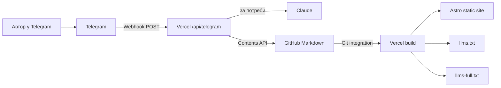

# ProPersonal Blog

Astro-блог із Telegram CMS, GitHub Markdown, Vercel Functions і build-time генерацією `llms.txt` через Anthropic Claude.

За основу взято готовий `astroblog_tgblogposter_md`. Збережено article-reading page, CTA, share buttons і Markdown-пайплайн. Додано головну сторінку зі статтями + кейсами, Telegram CMS через кнопки, build-time AI-файли та handoff-конфігурацію.

---

## 1. Що бачить відвідувач

Головна сторінка — тільки блог:

```text
Header
Featured article
Articles
Cases
Footer
```

Без landing-page блоків, services, stats, testimonials, contact form або видимих LLM-секцій.

Основні маршрути:

```text
/
/articles
/articles/<slug>
/cases
/llms.txt
/llms-full.txt
/sitemap.xml
/robots.txt
```

`llms.txt` і `llms-full.txt` — machine-facing endpoints; у frontend посилань на них немає.

Увесь видимий UI сайту та Telegram CMS — українською. Назви брендів/сервісів (`ProPersonal`, `Telegram`, `WhatsApp`, `LinkedIn`, `Threads`) залишаються власними назвами.

---

## 2. Mental model

Є чотири частини:

- **GitHub** — source of truth для коду й Markdown;
- **Vercel** — hosting, build і serverless Functions;
- **Telegram** — CMS UI;
- **Anthropic Claude** — Key Takeaways і `llms.txt` summaries.

VPS, daemon, Redis, Postgres або постійно запущений script не потрібні.



Після публікації:

1. Telegram надсилає update на `/api/telegram`.
2. Vercel перевіряє webhook secret.
3. Function створює Markdown.
4. Function комітить файл у GitHub.
5. GitHub запускає Vercel deployment.
6. `prebuild` генерує AI-файли.
7. Astro генерує static HTML.

---

## 3. Чому Telegram може викликати Vercel

Telegram не читає `WEBHOOK_SECRET` із Vercel.

Одноразово `/api/setup` викликає Telegram `setWebhook` і передає:

```text
url = https://DOMAIN/api/telegram
secret_token = WEBHOOK_SECRET
```

Telegram запам'ятовує їх. Потім кожен webhook містить:

```text
X-Telegram-Bot-Api-Secret-Token: <WEBHOOK_SECRET>
```

Vercel Function порівнює header зі своїм `process.env.WEBHOOK_SECRET`.

Отже:

```text
наш код -> Telegram API     TELEGRAM_BOT_TOKEN
Telegram -> наш webhook     WEBHOOK_SECRET
```

---

## 4. Структура repository

```text
.
├── api/
│   ├── telegram.ts
│   ├── setup.ts
│   └── _lib/
│       ├── anthropic.ts
│       ├── config.ts
│       ├── github.ts
│       ├── markdown.ts
│       └── telegram.ts
├── astro/
│   ├── scripts/generate-llms.mjs
│   ├── src/config.ts
│   ├── src/content/articles/*.md
│   ├── src/content/cases/*.md
│   ├── src/pages/index.astro
│   ├── src/pages/articles/
│   ├── src/pages/cases.astro
│   ├── src/layouts/ArticleLayout.astro
│   └── src/components/Share.astro
├── .env.example
├── vercel.json
├── HANDOFF.md
└── README.md
```

---

## 5. Де змінювати конфігурацію

### Frontend / branding

Файл:

```text
astro/src/config.ts
```

Там зібрані:

- `SITE_NAME`;
- `SITE_MARK`;
- `BLOG_SUBTITLE`;
- `SITE_DESCRIPTION`;
- `TELEGRAM_CHANNEL_URL`;
- `ARTICLES_URL`;
- `CASES_URL`;
- основні українські UI labels.

Наприклад, якщо кнопка **«Усі кейси»** має вести не на `/cases`, а на зовнішнє портфоліо клієнта:

```text
CASES_URL=https://client.example/cases
```

Це глобальний archive destination.

### Telegram / backend

Файл:

```text
api/_lib/config.ts
```

Там зібрані:

- content paths;
- model defaults;
- українські назви кнопок CMS;
- поля форми кейсу;
- максимальні довжини полів;
- runtime env vars.

Секрети не хардкодити у config — вони приходять тільки з Vercel Environment Variables.

---

## 6. Markdown — стаття

```md
---
title: "Назва статті"
slug: "nazva-statti"
date: "2026-08-10"
keyTakeaways: "3–4 короткі речення."
author: "ProPersonal"
---

## Розділ

Текст...
```

Article page містить:

- H1;
- дату й автора;
- блок **«Ключові висновки»** перед основним текстом;
- Markdown H2/H3;
- Telegram CTA;
- share buttons;
- `TechArticle` JSON-LD.

---

## 7. Markdown — кейс

```md
---
title: "Назва кейсу"
slug: "nazva-keisu"
date: "2026-08-10"
client: "ACME"
description: "Короткий опис для картки"
result: "-40% ручної роботи"
url: "https://external.example/case"
---

Додаткові нотатки кейсу...
```

`client`, `result`, `url` і body notes — опційні.

Якщо `url` заданий, картка кейсу відкриває зовнішнє джерело. Це **дані конкретного кейсу**, а не Vercel config.

---

## 8. Telegram CMS

Користувач не вводить `/publish`, `/help`, `/id` тощо.

Persistent keyboard:

```text
📝 Нова стаття      💼 Новий кейс
⚙️ Стан             🆔 Мій ID       ❓ Допомога
```

Нативна Telegram-кнопка Start технічно надсилає `/start`; код приймає її тільки для показу меню. Slash commands не реєструються як CMS workflow.

---

## 9. Публікація статті

Натиснути:

```text
📝 Нова стаття
```

Потім відповісти:

```text
Заголовок

Текст статті...
```

Опційно:

```text
Заголовок

Ключові висновки: Речення 1. Речення 2. Речення 3.

Текст статті...
```

Якщо висновків немає, Claude генерує їх автоматично.

Preview buttons:

```text
✅ Опублікувати статтю     ❌ Скасувати
✏️ Ключові висновки       ♻️ Згенерувати знову
```

Після Publish створюється:

```text
astro/src/content/articles/YYYY-MM-DD-slug.md
```

---

## 10. Публікація кейсу — кнопкова форма

Натиснути:

```text
💼 Новий кейс
```

Бот створює одне повідомлення-чернетку:

```text
🧩 Чернетка кейсу

Назва: —
Клієнт: —
Посилання: —
Результат: —
Опис: —

Нотатки:
—
```

Під ним inline buttons:

```text
✏️ Назва          🏢 Клієнт
🔗 Посилання      📈 Результат
📝 Опис           📎 Нотатки

✅ Опублікувати кейс
❌ Скасувати
```

### Як редагується поле

1. Натиснути, наприклад, `🏢 Клієнт`.
2. Бот відкриє Force Reply тільки для поля «Клієнт».
3. Надіслати `ACME`.
4. Бот редагує початкову чернетку:

```text
Клієнт: ACME
```

5. Натиснути наступне поле.
6. В кінці натиснути `✅ Опублікувати кейс`.

Щоб очистити поле, надіслати:

```text
—
```

Обов'язкова тільки `Назва`; також повинен бути хоча б один із `Опис`, `Посилання`, `Нотатки`.

### Зовнішній кейс

Заповнити поле:

```text
Посилання = https://client.example/case-study
```

Після публікації:

- Markdown отримує `url`;
- homepage card стає клікабельною;
- `/cases` card теж веде на source;
- `llms.txt` використовує зовнішній URL як ресурс кейсу.

Не потрібно змінювати Vercel env для кожного кейсу.

---

## 11. Чому для кнопкової форми не потрібна база даних

Vercel Functions не повинні покладатися на RAM між викликами.

Тому кейс-редактор не тримає draft у process memory.

Коли натискається кнопка поля:

1. callback містить поточний текст draft message;
2. bot надсилає Force Reply prompt;
3. prompt містить snapshot поточної чернетки + ID draft message;
4. наступна user reply містить цей prompt як `reply_to_message`;
5. Function відновлює draft зі snapshot;
6. змінює одне поле;
7. викликає `editMessageText` для початкової чернетки.

Тому немає Redis/Postgres/VPS, але UX виглядає як звичайна форма зі збереженням.

---

## 12. Claude / Anthropic

Vercel:

```text
ANTHROPIC_API_KEY=<secret>
ANTHROPIC_MODEL=claude-sonnet-5
```

Claude використовується для:

1. Key Takeaways, коли автор їх не задав;
2. build-time summaries для `/llms.txt`.

Crawler request до `/llms.txt` не викликає Claude. Файл уже статичний після build.

Якщо key/API тимчасово відсутній, build використовує deterministic Markdown fallback, щоб сайт не падав.

---

## 13. llms.txt / llms-full.txt

`astro/scripts/generate-llms.mjs` під час build:

- читає `src/content/articles/*.md`;
- читає `src/content/cases/*.md`;
- генерує `/llms.txt`;
- збирає `/llms-full.txt` із Markdown;
- генерує `robots.txt` із sitemap URL.

Article URL:

```text
/articles/<slug>
```

Case URL:

- external `url`, якщо він заданий;
- інакше `/#case-<slug>`.

---

## 14. Vercel Environment Variables

### Secrets

```text
TELEGRAM_BOT_TOKEN
ANTHROPIC_API_KEY
GITHUB_TOKEN
WEBHOOK_SECRET
SETUP_SECRET
```

### Config

```text
ANTHROPIC_MODEL=claude-sonnet-5
GITHUB_OWNER=<owner>
GITHUB_REPO=blogpropersonal
GITHUB_BRANCH=main
ADMIN_ID=<telegram-user-id>
ALLOWED_IDS=<id1,id2>
SITE_URL=https://domain.example
TELEGRAM_CHANNEL_URL=https://t.me/...
DEFAULT_AUTHOR=ProPersonal
ARTICLES_URL=/articles
CASES_URL=/cases
SITE_NAME=ProPersonal
SITE_MARK=PP
BLOG_SUBTITLE=Блог про AI-інтеграції та автоматизацію
SITE_DESCRIPTION=Практичні статті та кейси про AI-інтеграції й автоматизацію.
```

`.env.example` містить тільки шаблон, без реальних secrets.

---

## 15. GitHub token

Vercel Git integration сама по собі не дає `/api/telegram` permission на створення Markdown.

Потрібен client-owned fine-grained PAT для blog repo:

```text
Repository permissions
  Contents: Read and write
```

Зберігати у Vercel як:

```text
GITHUB_TOKEN
```

---

## 16. Webhook setup

Після заповнення production envs:

```text
https://DOMAIN/api/setup
```

Сторінка українською й захищена `SETUP_SECRET`.

Доступні дії:

- Зареєструвати / перереєструвати webhook;
- Перевірити стан webhook;
- Видалити webhook.

Під час registration:

1. реєструється `${SITE_URL}/api/telegram`;
2. Telegram отримує `WEBHOOK_SECRET` як `secret_token`;
3. старі slash commands видаляються;
4. custom menu button скидається на default.

---

## 17. Коли треба перереєстровувати webhook

| Зміна | Redeploy | Re-register webhook |
|---|---:|---:|
| `SITE_URL` / domain | так | **так** |
| `TELEGRAM_BOT_TOKEN` | так | **так** |
| `WEBHOOK_SECRET` | так | **так** |
| `SETUP_SECRET` | так | ні |
| `ANTHROPIC_API_KEY` | так | ні |
| `GITHUB_TOKEN` | так | ні |
| `GITHUB_OWNER` / `GITHUB_REPO` | так | ні |
| `ADMIN_ID` / `ALLOWED_IDS` | так | ні |
| frontend labels/config | так | ні |

---

## 18. Handoff у клієнтську інфраструктуру

Рекомендований порядок:

1. Transfer/fork repo у client GitHub.
2. Створити client-owned fine-grained PAT.
3. Import repo у client Vercel.
4. Перенести домен.
5. Створити/передати Telegram bot.
6. Створити client Anthropic key.
7. Згенерувати нові `WEBHOOK_SECRET` і `SETUP_SECRET`.
8. Додати env vars у Vercel.
9. Redeploy.
10. Відкрити `/api/setup`.
11. Re-register webhook.
12. Перевірити `🆔 Мій ID` і `ADMIN_ID`.
13. Опублікувати test article.
14. Опублікувати test case через кнопкову форму.
15. Перевірити GitHub commit → Vercel deployment → frontend.
16. Перевірити `/llms.txt`, `/llms-full.txt`, `/sitemap.xml` і JSON-LD.
17. Видалити developer credentials після приймання.

Детальний checklist також є в `HANDOFF.md`.

---

## 19. Acceptance checklist

```text
[ ] Homepage = featured article + articles + cases
[ ] Responsive mobile/tablet/desktop
[ ] Article reader працює
[ ] Ключові висновки перед основним текстом
[ ] Telegram CTA працює
[ ] Share buttons працюють
[ ] TechArticle JSON-LD присутній
[ ] Telegram CMS українською
[ ] Case draft редагується окремими кнопками
[ ] External case URL працює
[ ] GitHub Markdown створюється ботом
[ ] Commit запускає Vercel deployment
[ ] /llms.txt працює
[ ] /llms-full.txt працює
[ ] /sitemap.xml працює
[ ] Secrets не лежать у GitHub
[ ] /api/setup українською і захищений SETUP_SECRET
```
