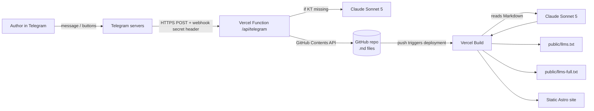
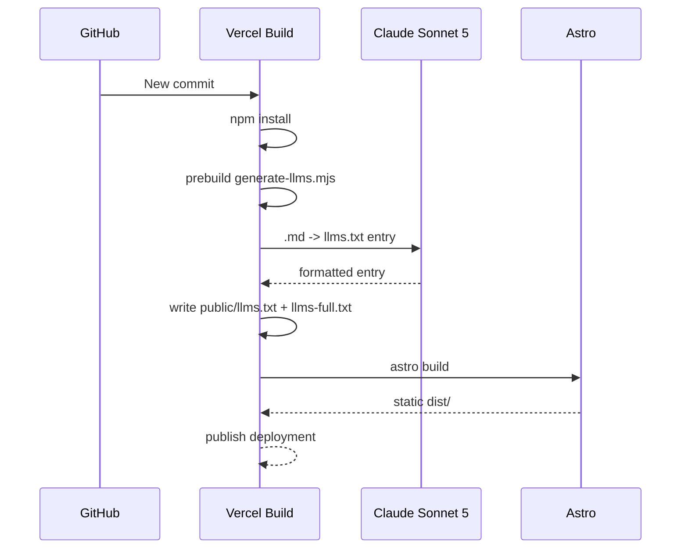
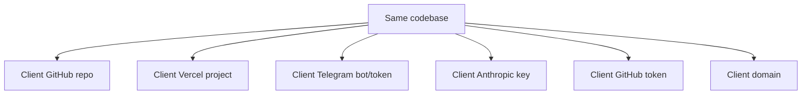

# ProPersonal Blog — Astro + Telegram CMS + Claude + Vercel

Цей репозиторій — повністю self-contained реалізація блогу з ТЗ: статичний Astro-сайт, Markdown як база контенту, AI/AIO-оптимізація, кейси на головній сторінці, Telegram-публікація через кнопки, GitHub як source of truth і Vercel як єдина runtime/build інфраструктура.

**VPS не потрібен. База даних не потрібна. Окремий daemon/worker не потрібен.**

Для production потрібні лише:

- GitHub repository;
- Vercel project, підключений до repository;
- Telegram bot token;
- Anthropic API key;
- GitHub token з `Contents: Read and write`;
- домен (опційно, Vercel domain теж працює);
- кілька Environment Variables у Vercel.

> Якщо ви передаєте проєкт клієнту, відкрийте також [`HANDOFF.md`](./HANDOFF.md). Там є покроковий сценарій без припущень про попередню інфраструктуру.

---

## 1. Mental model: що тут насправді відбувається

Є три системи і один source of truth:

1. **Telegram** — лише UI для автора контенту.
2. **Vercel Function** — приймає Telegram webhook і виконує backend-логіку.
3. **Vercel Build** — збирає Astro, генерує `llms.txt`/`llms-full.txt` і статичні сторінки.
4. **GitHub repository** — єдиний постійний source of truth для контенту та коду.



### Найважливіше

Коли людина пише боту, **Telegram app на телефоні не звертається напряму до Vercel**.

Потік такий:

1. користувач надсилає повідомлення Telegram;
2. Telegram server бачить, що для бота зареєстровано webhook URL;
3. Telegram server робить `POST https://YOUR_DOMAIN/api/telegram`;
4. Telegram додає header `X-Telegram-Bot-Api-Secret-Token`;
5. Vercel Function порівнює цей header із `WEBHOOK_SECRET` у Vercel;
6. тільки після цього обробляє update.

`WEBHOOK_SECRET` не витягується Telegram-ом з Vercel. **Ми один раз передаємо його Telegram при `setWebhook`.** Telegram запам'ятовує секрет і надсилає його назад у кожному webhook request.

---

## 2. Чому немає VPS

Backend знаходиться в `api/*.ts`. Vercel автоматично перетворює ці файли на Functions.

- `/api/telegram` — Telegram webhook;
- `/api/setup` — protected UI для register/re-register/delete/check Telegram webhook.

Function запускається лише коли приходить request. Немає процесу, який треба тримати online вручну.

Контент після публікації комітиться у GitHub. Цей commit автоматично запускає новий Vercel deployment.

---

## 3. Структура repository

```text
.
├── api/
│   ├── telegram.ts              # Telegram CMS webhook
│   ├── setup.ts                 # Protected webhook setup page
│   └── _lib/
│       ├── anthropic.ts         # Claude Sonnet 5 calls for Key Takeaways
│       ├── config.ts            # Runtime env configuration
│       ├── github.ts            # Commit .md through GitHub Contents API
│       ├── markdown.ts          # Telegram -> Markdown/frontmatter
│       └── telegram.ts          # Thin Telegram Bot API client
├── astro/
│   ├── scripts/
│   │   └── generate-llms.mjs    # Build-time Claude -> llms.txt
│   ├── public/
│   ├── src/
│   │   ├── content/
│   │   │   ├── articles/*.md
│   │   │   └── cases/*.md
│   │   ├── pages/
│   │   ├── layouts/
│   │   ├── components/
│   │   └── styles/
│   ├── package.json
│   └── tailwind.config.mjs
├── .env.example
├── vercel.json
├── HANDOFF.md
└── README.md
```

---

## 4. Сайт

Головна сторінка має саме необхідну структуру:

- hero/introduction;
- **Articles**;
- **Cases на цій же головній сторінці**;
- CTA;
- links на `llms.txt` та `llms-full.txt`.

Окремі article/case routes залишаються, бо кожному матеріалу потрібна canonical URL:

```text
/articles/<slug>
/cases/<slug>
```

### Article page

Кожна стаття автоматично має:

- H1;
- Answer-First блок `Key Takeaways`;
- Markdown H2/H3 content;
- canonical URL;
- `TechArticle` JSON-LD;
- social share links;
- CTA на Telegram.

### Case page

Кожен case має:

- canonical route;
- description/result;
- `Article` JSON-LD;
- share links;
- CTA.

---

## 5. Markdown — база даних контенту

Ніякої CMS database немає.

Стаття:

```md
---
title: "Article title"
slug: "article-title"
date: "2026-08-10"
keyTakeaways: "3-4 sentences..."
author: "Pro Personal Agency"
---

## Heading

Article body...
```

Case:

```md
---
title: "Case title"
slug: "case-title"
date: "2026-08-10"
description: "Short card description"
client: "Optional client"
result: "Optional result"
---

## Problem
...
```

GitHub — це permanent storage. Якщо Vercel project видалити і створити заново, контент не губиться.

---

## 6. Telegram CMS: без typed commands

Автор не повинен пам'ятати `/publish`, `/help` тощо.

Після стандартної Telegram кнопки **Start** бот показує persistent keyboard:

- `📝 New article`
- `💼 New case`
- `⚙️ Status`
- `🆔 My ID`
- `❓ Help`

`/start` існує лише як технічний payload, який Telegram сам надсилає після native Start button. Людина не повинна його вводити.

### Publish article

1. Tap `📝 New article`.
2. Bot показує reply prompt.
3. Надіслати:

```text
Article title

Article body...
```

Опційно manual Key Takeaways:

```text
Article title

Key Takeaways: Sentence one. Sentence two. Sentence three.

Article body...
```

4. Якщо Key Takeaways не задані — Vercel Function викликає Claude Sonnet 5.
5. Bot показує preview.
6. Inline buttons:
   - Publish article;
   - Cancel;
   - Edit Key Takeaways;
   - Regenerate Key Takeaways.
7. Publish commits `.md` у GitHub.
8. GitHub commit запускає Vercel build.

### Publish case

1. Tap `💼 New case`.
2. Reply:

```text
Case title

Case body...
```

3. Bot створює preview.
4. Tap `Publish case`.
5. `.md` потрапляє в `astro/src/content/cases/`.

### Чому Telegram CMS не потребує Redis/DB

Vercel Functions stateless. Тому workflow спеціально побудований навколо Telegram message replies та inline callback buttons.

Preview відповідає на оригінальний submission message. Коли користувач натискає `Publish`, callback містить preview message, а preview посилається на вихідний Telegram message. Function може знову прочитати початковий content без server-side session storage.

---

## 7. Claude Sonnet 5

Default API model ID:

```text
claude-sonnet-5
```

Його можна замінити без зміни коду через:

```text
ANTHROPIC_MODEL
```

### Claude використовується у двох місцях

#### A. Key Takeaways

Якщо Telegram-автор не задав Key Takeaways вручну, `api/_lib/anthropic.ts` робить Claude call і записує результат у Markdown перед GitHub commit.

Це важливо: generated Key Takeaways стають частиною repository content, а не випадковим runtime output.

Також `astro/scripts/generate-llms.mjs` має fallback: якщо хтось вручну commit-нув `.md` без `keyTakeaways`, build викликає Claude і додає поле у build-time copy Markdown перед Astro render.

Build filesystem Vercel є тимчасовим, тому build-time fallback **не комітить назад у GitHub**. Для Telegram flow Key Takeaways зберігаються постійно ще до deployment.

#### B. `/llms.txt`

На кожному production build script читає `.md` матеріали та для кожного просить Claude повернути тільки один `llms.txt`-formatted resource entry.

Після цього код детерміновано збирає один site-level:

```text
https://DOMAIN/llms.txt
```

Це не runtime Claude request. Crawler, який відкриває `/llms.txt`, отримує вже готовий static file.

---

## 8. `/llms-full.txt`

`llms-full.txt` не потребує summarization.

Build script копіює повний Markdown-derived content статей та кейсів і додає canonical URL кожного матеріалу.

```text
https://DOMAIN/llms-full.txt
```

Це дає AI-agent повний corpus без необхідності обходити HTML сторінки.

---

## 9. Build lifecycle

`vercel.json` запускає:

```text
cd astro && npm install
cd astro && npm run build
```

`npm run build` автоматично запускає `prebuild`:

```text
node scripts/generate-llms.mjs
```

Отже порядок:



---

## 10. Environment Variables

Copy `.env.example` mentally; **do not commit real values**.

| Variable | Required | Secret? | Used for |
|---|---:|---:|---|
| `TELEGRAM_BOT_TOKEN` | yes | yes | calling Telegram API / identifying the bot |
| `ANTHROPIC_API_KEY` | yes | yes | Claude API |
| `ANTHROPIC_MODEL` | no | no | defaults to `claude-sonnet-5` |
| `GITHUB_TOKEN` | yes | yes | creating/updating Markdown files |
| `GITHUB_OWNER` | yes | no | destination repo owner |
| `GITHUB_REPO` | yes | no | destination repo name |
| `GITHUB_BRANCH` | yes | no | usually `main` |
| `WEBHOOK_SECRET` | yes | yes | Telegram -> Vercel request verification |
| `SETUP_SECRET` | yes | yes | protects `/api/setup` admin UI |
| `ADMIN_ID` | recommended | no | Telegram admin user ID |
| `ALLOWED_IDS` | optional | no | comma-separated extra publishers/channel IDs |
| `SITE_URL` | yes | no | final production URL/canonical URL/webhook origin |
| `TELEGRAM_CHANNEL_URL` | recommended | no | CTA target on site |
| `DEFAULT_AUTHOR` | optional | no | article byline |

### Generate secrets

`WEBHOOK_SECRET` must follow Telegram's allowed characters: letters, digits, `_`, `-`.

Example generation on macOS/Linux:

```bash
openssl rand -hex 32
```

Hex is valid for `WEBHOOK_SECRET` and `SETUP_SECRET`.

---

## 11. Webhook registration

Do **not** paste the Telegram bot token or webhook secret into a public browser URL.

This repo provides:

```text
https://YOUR_DOMAIN/api/setup
```

Open it, enter `SETUP_SECRET`, then choose:

- Register / re-register webhook;
- Check webhook status;
- Delete webhook.

When Register is pressed, the Vercel Function performs Telegram `setWebhook` with:

```text
URL: https://YOUR_DOMAIN/api/telegram
secret_token: WEBHOOK_SECRET
```

After this Telegram stores both values.

### When must webhook be re-registered?

| Change | Redeploy? | Re-register webhook? |
|---|---:|---:|
| `SITE_URL` / domain | yes | **yes** |
| `TELEGRAM_BOT_TOKEN` / new bot | yes | **yes** |
| `WEBHOOK_SECRET` | yes | **yes** |
| `SETUP_SECRET` | yes | no |
| `ANTHROPIC_API_KEY` | yes | no |
| `ANTHROPIC_MODEL` | yes | no |
| `GITHUB_TOKEN` | yes | no |
| `GITHUB_OWNER/REPO/BRANCH` | yes | no |
| `ADMIN_ID` / `ALLOWED_IDS` | yes | no |
| `TELEGRAM_CHANNEL_URL` | yes | no |
| article/case content | automatic deployment | no |

**Rule:** webhook re-registration потрібна, якщо змінилося *куди Telegram дзвонить*, *який Telegram bot використовується*, або *який secret Telegram повинен надсилати*.

---

## 12. GitHub token

Telegram Function не може записувати `.md` у repository лише тому, що Vercel підключений до GitHub.

Потрібен окремий GitHub credential.

Recommended: fine-grained Personal Access Token, scoped тільки до цього repository, з permission:

```text
Repository permissions -> Contents -> Read and write
```

Token зберігається тільки у Vercel `GITHUB_TOKEN`.

Він не потрібен у frontend і не повинен мати доступу до зайвих repositories.

---

## 13. First deployment — правильний порядок

Повний zero-to-production порядок є в [`HANDOFF.md`](./HANDOFF.md). Скорочено:

1. GitHub repo готовий.
2. Telegram bot створений.
3. Anthropic key створений.
4. GitHub fine-grained token створений.
5. Import GitHub repo into Vercel.
6. Add Environment Variables.
7. Deploy.
8. Attach final domain.
9. Set `SITE_URL` to final domain.
10. Redeploy.
11. Open `/api/setup` and Register webhook.
12. Open Telegram bot and press Start.
13. Tap `🆔 My ID`.
14. Put that ID into `ADMIN_ID`.
15. Redeploy.
16. Publish test article.
17. Confirm GitHub `.md` commit.
18. Confirm Vercel deployment.
19. Confirm article URL, `/llms.txt`, `/llms-full.txt`, `/sitemap.xml`.

---

## 14. Client handoff mental model

Під час handoff **код не переписується**.

Змінюється ownership/credentials/configuration:



Немає hidden state на нашому сервері, бо нашого сервера немає.

Після передачі клієнту ми можемо revoke/delete наші credentials, і production продовжить працювати на credentials клієнта.

---

## 15. Domain replacement

При зміні домену з:

```text
https://old.example.com
```

на:

```text
https://blog.client.com
```

потрібно:

1. додати/перенести domain у Vercel;
2. перевірити DNS;
3. змінити `SITE_URL=https://blog.client.com`;
4. redeploy;
5. відкрити `https://blog.client.com/api/setup`;
6. Register / re-register webhook;
7. Check webhook status;
8. test bot publish.

Причина: `SITE_URL` використовується і для canonical URLs, і для Telegram webhook URL, і для links у bot responses, і для `llms.txt`.

---

## 16. Telegram bot replacement

Якщо клієнт створює зовсім нового бота:

1. за можливості Delete webhook старого бота через `/api/setup` до зміни token;
2. замінити `TELEGRAM_BOT_TOKEN` у Vercel;
3. redeploy;
4. Register webhook через `/api/setup`;
5. відкрити нового бота -> Start;
6. `🆔 My ID`;
7. update `ADMIN_ID` / `ALLOWED_IDS`;
8. redeploy;
9. test publish.

`WEBHOOK_SECRET` можна залишити тим самим або rotate. Якщо rotate — після redeploy обов'язково Register webhook ще раз.

---

## 17. GitHub repo ownership replacement

Після GitHub Transfer ownership або переходу на новий client repo:

1. переконатися, що Vercel Git integration має доступ до нового repo;
2. update:
   - `GITHUB_OWNER`;
   - `GITHUB_REPO`;
   - `GITHUB_BRANCH`;
3. створити **client-owned** fine-grained PAT для нового repo;
4. replace `GITHUB_TOKEN`;
5. redeploy;
6. publish test article from Telegram;
7. verify commit appears саме в client repo;
8. verify commit triggers Vercel deployment.

Webhook re-registration не потрібна, якщо domain/bot/webhook secret не змінювались.

---

## 18. Security boundaries

### Public

- static site;
- `/llms.txt`;
- `/llms-full.txt`;
- `/sitemap.xml`;
- `/api/telegram` URL itself;
- `/api/setup` page itself.

### Secret

- `TELEGRAM_BOT_TOKEN`;
- `ANTHROPIC_API_KEY`;
- `GITHUB_TOKEN`;
- `WEBHOOK_SECRET`;
- `SETUP_SECRET`.

`/api/telegram` може бути public URL — це нормально. Security не базується на тому, що URL ніхто не знає. Кожен Telegram request перевіряється по secret header.

`/api/setup` також public URL, але будь-яка mutation потребує `SETUP_SECRET`.

---

## 19. Troubleshooting

### Bot does not answer at all

1. Open `/api/setup`.
2. Check webhook status.
3. Verify Telegram reports the expected URL.
4. Verify `last_error_message` if present.
5. Make sure production URL is not protected by Vercel Authentication/Deployment Protection in a way that blocks Telegram.
6. If domain or secret changed, Register again.

### `/api/telegram` returns `401`

`WEBHOOK_SECRET` у Vercel не збігається з secret stored by Telegram.

Fix:

1. redeploy with correct `WEBHOOK_SECRET`;
2. `/api/setup` -> Register / re-register.

### Telegram says publishing is disabled

Tap `🆔 My ID`, then add it to:

```text
ADMIN_ID=<id>
```

or:

```text
ALLOWED_IDS=123456,987654
```

Redeploy. Re-register webhook is **not** required.

### GitHub 401/403

Check:

- token not expired/revoked;
- correct `GITHUB_OWNER`;
- correct `GITHUB_REPO`;
- fine-grained token has selected repository;
- `Contents: Read and write`.

### Article commits, but Vercel does not deploy

The publishing Function did its job. The Git integration is the failing link.

Check that Vercel project is connected to the same repo/branch configured by `GITHUB_OWNER/GITHUB_REPO/GITHUB_BRANCH`.

### Build fails: `ANTHROPIC_API_KEY is required`

Add Anthropic key to the **Production** Environment in Vercel and redeploy.

### Build fails: `SITE_URL is required`

Set full URL including `https://`, e.g.:

```text
SITE_URL=https://blog.client.com
```

### Claude API 400 after model migration

Check `ANTHROPIC_MODEL`. Current default for this repo is:

```text
claude-sonnet-5
```

The model is deliberately configurable so future migration is one Vercel variable change.

### `/llms.txt` is stale

`llms.txt` is a build artifact, not a runtime endpoint. Confirm the commit produced a successful new deployment. Opening the old deployment URL will still show its old artifact.

---

## 20. Local development

Create local variables from `.env.example` if needed.

To build without paying for Claude calls during purely structural local validation:

```bash
cd astro
npm install
SKIP_LLM_GENERATION=1 SITE_URL=http://localhost:4321 npm run build
```

`SKIP_LLM_GENERATION=1` is only a developer convenience. Do not set it in Vercel Production.

Production should have:

```text
ANTHROPIC_API_KEY=...
ANTHROPIC_MODEL=claude-sonnet-5
```

---

## 21. ТЗ compliance map

| ТЗ | Implementation |
|---|---|
| Astro / static generation | `astro/`, `output: 'static'` |
| Tailwind CSS | Tailwind + PostCSS in `astro/` |
| Local Markdown database | `src/content/articles`, `src/content/cases` |
| GitHub + Vercel | GitHub source + `vercel.json` |
| Answer-First Key Takeaways | `ArticleLayout.astro` + Claude/manual input |
| H1/H2/H3 | H1 layout + Markdown body hierarchy |
| JSON-LD | `TechArticle` / `Article` layouts |
| `/llms.txt` | build-time Claude generation |
| `/llms-full.txt` | direct Markdown aggregation |
| CTA under articles | `ArticleLayout.astro` |
| Social share | `Share.astro` |
| Cases | section on homepage + canonical detail routes |
| Telegram automation | `/api/telegram` |
| `.md` appears in GitHub | GitHub Contents API |
| Auto deployment | Vercel Git integration after commit |
| Mobile/desktop | responsive Tailwind layout |
| Ownership handoff | no hardcoded credentials; see `HANDOFF.md` |

---

## 22. Official documentation used by this implementation

- Vercel Functions: https://vercel.com/docs/functions
- Vercel Environment Variables: https://vercel.com/docs/environment-variables
- Telegram Bot API (`setWebhook`, `secret_token`, buttons): https://core.telegram.org/bots/api
- GitHub Contents API: https://docs.github.com/en/rest/repos/contents
- Claude Messages API: https://platform.claude.com/docs/en/api/messages/create
- Claude authentication: https://platform.claude.com/docs/en/manage-claude/authentication
- Claude Sonnet 5: https://platform.claude.com/docs/en/about-claude/models/whats-new-sonnet-5

---

## 23. Production definition of done

Перед передачею клієнту перевірити всі пункти:

- [ ] client GitHub repo contains full project;
- [ ] Vercel connected to correct repo + production branch;
- [ ] final domain resolves to Vercel;
- [ ] all Production env vars set;
- [ ] credentials belong to client, not developer;
- [ ] `/api/setup` reports correct webhook URL;
- [ ] Telegram Start shows button CMS;
- [ ] test article can be published without typed commands;
- [ ] `.md` appears in GitHub;
- [ ] deployment starts automatically;
- [ ] homepage shows article;
- [ ] homepage shows cases section;
- [ ] article has Key Takeaways;
- [ ] article has JSON-LD in HTML;
- [ ] `/llms.txt` works;
- [ ] `/llms-full.txt` works;
- [ ] `/sitemap.xml` works;
- [ ] CTA + share links work;
- [ ] developer credentials revoked after client confirms production.
